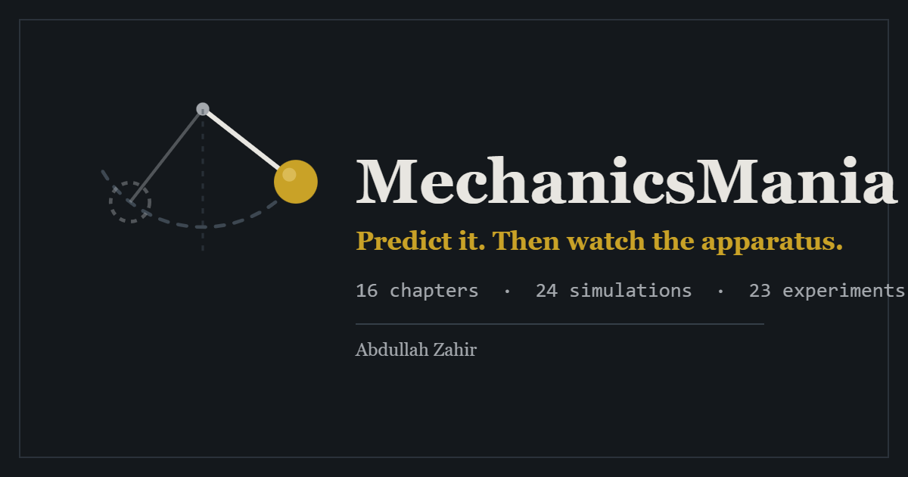

# MechanicsMania

### [www.mechanicsmania.com](https://www.mechanicsmania.com)

An AP Physics C: Mechanics workbench — a solver that shows its working, a sandbox
that integrates the real equations, and 23 predict-then-watch minigames.

Founded by **Abdullah Zahir** for the purpose of advancing and easing physics knowledge.



---

## What it does

**Solve.** 16 chapters, 43 problem types. You pick the quantity you want, answer a
few setup questions, and get the answer with the rearranged equation and your own
numbers substituted into it. Every printed working line is checked against the
answer before it is shown — if the two disagree, the line is withheld rather than
displayed wrong.

**Play.** 24 sandbox simulations that integrate their equations of motion rather
than replaying a closed form, with live readouts, a graph panel, and a handoff
that carries the configuration straight into the solver.

**Practise.** 23 minigames across all seven units. Each one asks you to compute a
number *first*, then runs the apparatus on **your** number — so a wrong answer
fails in a way you can see, and the way it fails tells you which mistake you made.
About 150 named misconceptions are detected by name.

**Earn.** Twelve badges, kept in the top-left corner. Eight **unit badges** come
from the solver: solve one problem of every type a unit holds and its badge is
yours — Kinematics, Forces, Momentum, Energy, Rotation, Gravitation,
Oscillations, and The Classics. The other four are the **Elite Four**, and they
are earned in the lab rather than on paper:

| Badge | Earned by |
|---|---|
| Simulation | running a simulation from every unit in the sandbox |
| Experiment | scoring a direct hit in an experiment from every unit |
| Analysis | linearising a run — a straight-line fit of R² ≥ 0.99 — in three simulations |
| Mastery | a direct hit on the hardest setting of five different experiments |

Progress is stored in the browser only. There is no account and nothing is sent
anywhere.

## Running it locally

Requires Python 3.10+.

```bash
pip install -r backend/requirements.txt
python -m uvicorn main:app --port 8080 --app-dir backend
```

Then open <http://localhost:8080>.

On Windows, `run.bat` does the same thing.

### A note on `--reload`

Uvicorn's `--reload` has proved unreliable for `backend/physics/solvers.py` on at
least one machine: the watcher reported reloading while the process kept serving
the previous module, so edits appeared to have no effect. If a change to the
physics does not show up, restart the server rather than trusting the watcher.

## How it is laid out

```
backend/
  main.py              FastAPI app: /api/config, /api/solve, static files
  physics/
    solvers.py         every relation, one function per chapter
    data.py            chapters, variable names, tips, marginalia, reference
frontend/
  index.html           every screen, as plain markup
  app.js               screen flow, the solver UI, the minigame host
  badges.js            the twelve badges: requirements, storage, drawing
  scenarios.js         CHAPTER_FLOW — which chapter has which problem types
  animate.js           the solver's animations and free-body diagrams
  playground.js        the sandbox: integrators, scenarios, drawing
  playgraph.js         the sandbox graph panel and linearisation
  minigames.js  balloondrop.js  flyingpig.js
  racegames.js  rampgames.js  topicgames.js  demogames.js
                       the 23 minigames, grouped by unit
  style.css            the design system
```

There is no build step. The frontend is plain `<script>` tags, deliberately — the
source you read is the source that runs.

## Design rules the code follows

- **A sandbox integrates; it does not replay.** Closed forms are used as runtime
  parity checks against the integrator, never as the motion itself.
- **A minigame round is built backwards from its answer.** Fix the window the
  answer must land in, then choose the givens that steer it there — never sample
  givens and hope.
- **A reveal is integrated from the student's number.** Feed their answer into the
  same motion and let the apparatus do the wrong thing by itself.
- **Fail closed.** If a quantity cannot be computed, show nothing rather than
  something wrong.
- **Nothing on a posed stage may be the answer.** The apparatus draws
  "— work it out" in the slot until a number has been committed.

## Brand assets

`frontend/brand/` holds the logo at two sizes and the canvas source that draws
them, so they can be regenerated rather than re-drawn:

| File | Size | For |
|---|---|---|
| `logo-400.png` | 400 × 400 | **LinkedIn** — its recommended logo size |
| `logo-300.png` | 300 × 300 | smaller avatars |
| `logo-160.png` | 160 × 160 | inline badges, README icons |
| `logo-mark.png` | 1024 × 1024 | the mark alone, transparent — print, large avatars |
| `logo-square.png` | 1024 × 1024 | mark with the wordmark — project thumbnails |
| `logo-banner.png` | 1200 × 630 | link previews, LinkedIn project media |
| `logo-source.html` | — | open in a browser to redraw all three |

The mark is drawn from the same path data as `frontend/favicon.svg`, so the icon
and the logo cannot drift apart.

## Licence

Not yet chosen. Add one before sharing the repository publicly.
